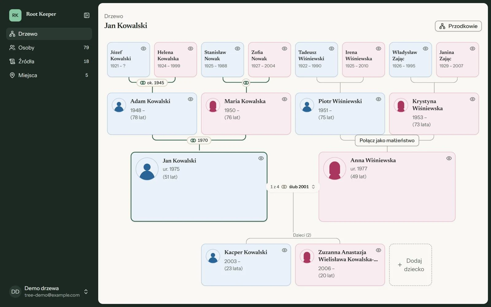
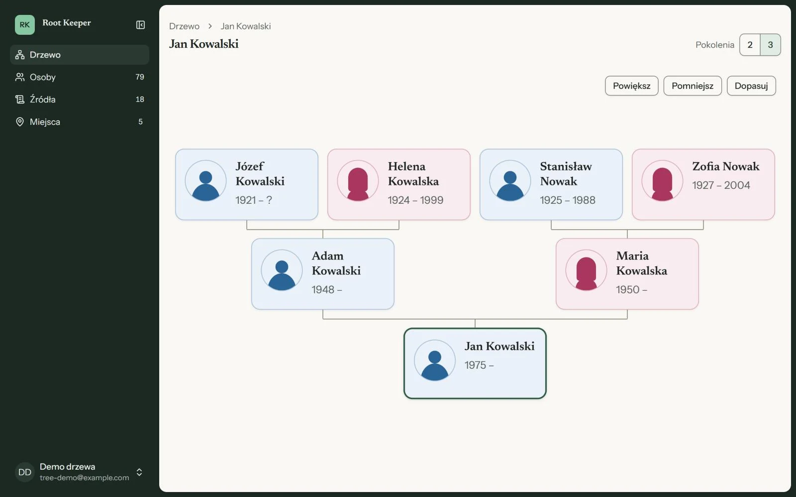
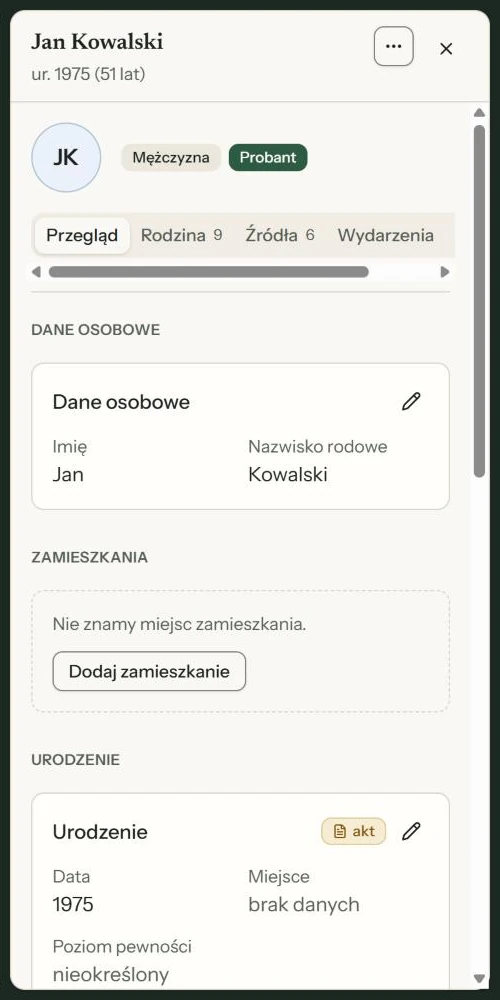

<div align="center">

# Root Keeper

**A family tree where every date has a source: a parish record, a civil registry entry or a gravestone.**

[](https://genealogy.kostecki.dev)
[](https://github.com/sebastian-kostecki/root-keeper/releases/latest)
[](https://github.com/sebastian-kostecki/root-keeper/actions/workflows/tests.yml)
[](https://github.com/sebastian-kostecki/root-keeper/actions/workflows/e2e.yml)
[](CHANGELOG.md)

[](https://www.php.net/)
[](https://laravel.com/)
[](https://inertiajs.com/)
[](https://react.dev/)
[](https://www.typescriptlang.org/)
[](https://tailwindcss.com/)
[](https://www.postgresql.org/)

[Live app](https://genealogy.kostecki.dev) · [Changelog](CHANGELOG.md) · [Roadmap](context/foundation/roadmap.md) · [Report a bug](https://github.com/sebastian-kostecki/root-keeper/issues/new)

**English** · [Polski](README.pl.md)

</div>

<p align="center">
  
</p>

## About

Root Keeper is a private, self-hosted family tree for after-hours genealogy research, where "probably" is not good enough. Every birth, marriage and death can point to the record that proves it, together with its scan, the entry number and a confidence level. Each account owns exactly one tree and sees only its own data. The interface is in Polish.

## Features

- **Family sheet** — the tree starts right after sign-in and fills the window: parents, grandparents, spouses and children around the person in the centre, with relations added straight from empty slots.
- **Ancestors view** — a pedigree with a depth switch (2–5 generations), zoom and pan.
- **Sources with scans** — parish and civil records, books and gravestones described by kind, parish, year, record type, archive and reference, each with an uploaded scan, linked to facts with the entry number.
- **Fuzzy dates and confidence** — an exact date, "about", a year range, "before" or "after", plus a confidence level A–D (original record, index, hint, hypothesis).
- **People** — surname spelling variants found by search, a birth surname, marriage form, residences with years and an events timeline with age.
- **Places index** — localities with name variants, parishes and civil offices, and cemeteries on one page, with duplicate merging.
- **Import from a research repository** — `import:research` reads structured data blocks from Markdown research notes, shows a summary, matches people already entered by hand, lets you resolve conflicts one by one and writes only what you approve. Re-running the import updates instead of duplicating.
- **Sign-in** — password or passkey, e-mail verification and rate-limited registration.

<table>
  <tr>
    <td width="66%"></td>
    <td width="34%"></td>
  </tr>
  <tr>
    <td align="center"><sub>Ancestors view</sub></td>
    <td align="center"><sub>Person panel with a sourced birth</sub></td>
  </tr>
</table>

<sub>Screenshots use the fictional family from `TreeViewDemoSeeder`.</sub>

## Tech stack

| Layer | Technology |
| --- | --- |
| Backend | PHP 8.5, Laravel 13, Inertia 3, Fortify (passwords and passkeys), Wayfinder |
| Frontend | React 19 with the React Compiler, TypeScript, Tailwind CSS 4, shadcn/ui, Vite+ (Oxlint, Oxfmt) |
| Database | PostgreSQL 18 |
| Quality | Pest 5 / PHPUnit 13, Larastan level 7, Laravel Pint, Vitest, Playwright |
| Infrastructure | Laravel Sail locally; Docker Compose behind Traefik on a VPS, encrypted Spatie backups |

## Getting started

### Prerequisites

- Docker ([Laravel Sail](https://laravel.com/docs/sail)); every `php`, `artisan`, `composer`, `npm` and `npx` command runs through `vendor/bin/sail`

### Installation

```bash
git clone https://github.com/sebastian-kostecki/root-keeper.git
cd root-keeper

cp .env.example .env
./vendor/bin/sail up -d
./vendor/bin/sail artisan key:generate
./vendor/bin/sail artisan migrate --seed
./vendor/bin/sail npm install
./vendor/bin/sail npm run dev
```

The app runs on <http://localhost:8000> (`APP_PORT`).

### Demo data

```bash
./vendor/bin/sail artisan db:seed --class=TreeViewDemoSeeder   # tree-demo@example.com / password
./vendor/bin/sail artisan db:seed --class=AncestorsDemoSeeder  # ancestors-demo@example.com / password
```

`migrate --seed` creates `test@example.com` / `password` with an empty tree. The two demo seeders create their own accounts with a fictional family (the first one also with sources and scans) and replace them when run again.

## Development

| Command | What it does |
| --- | --- |
| `sail composer test` | Lint, Larastan and the Pest suite |
| `sail composer types:check` | Larastan (level 7) |
| `sail bin pint --dirty --format agent` | Code style |
| `sail npm run check` | Oxfmt and Oxlint (warnings fail the build) |
| `sail npm run types:check` | TypeScript |
| `sail npm run test:js` | Vitest |
| `npx playwright test` | Playwright E2E against a separate Sail container on port 8100 |

Four GitHub Actions workflows run on every push and pull request:

| Workflow | What it checks |
| --- | --- |
| [`lint`](.github/workflows/lint.yml) | Oxlint and Oxfmt, warnings treated as errors |
| [`static-analysis`](.github/workflows/static-analysis.yml) | Larastan level 7 |
| [`tests`](.github/workflows/tests.yml) | Pest feature and unit tests |
| [`e2e`](.github/workflows/e2e.yml) | Playwright end-to-end tests |

Work happens on `develop`; `main` is the release branch.

## How it is built

The product is shaped in [`context/foundation/`](context/foundation/): PRD, roadmap, infrastructure, test plan and health checks. Each change gets its own folder in `context/changes/` with research, a plan and an implementation review, and moves to [`context/archive/`](context/archive/) when it ships. Coding agents (Claude Code) follow [`CLAUDE.md`](CLAUDE.md), and every change lands through a pull request with green CI.

## Deployment

Production runs on a VPS with `docker-compose.prod.yml` behind Traefik. `scripts/deploy.sh` takes a database backup (`backup:run --only-db`) before every `migrate`; nightly backups are encrypted. Details: [`context/foundation/infrastructure.md`](context/foundation/infrastructure.md).

## Project status

Version **0.3.1** runs in production at [genealogy.kostecki.dev](https://genealogy.kostecki.dev). Milestone M-3 "research from the repository visible in the tree" is done; see the [roadmap](context/foundation/roadmap.md) and the [changelog](CHANGELOG.md).

## License

No open-source license has been chosen yet, so all rights are reserved © Sebastian Kostecki. You are welcome to read the code; ask before reusing it.
