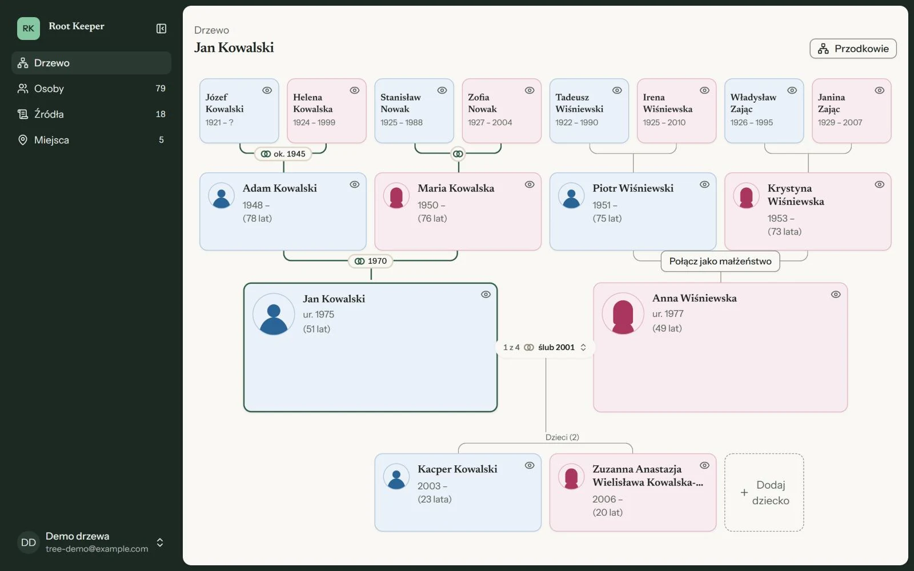
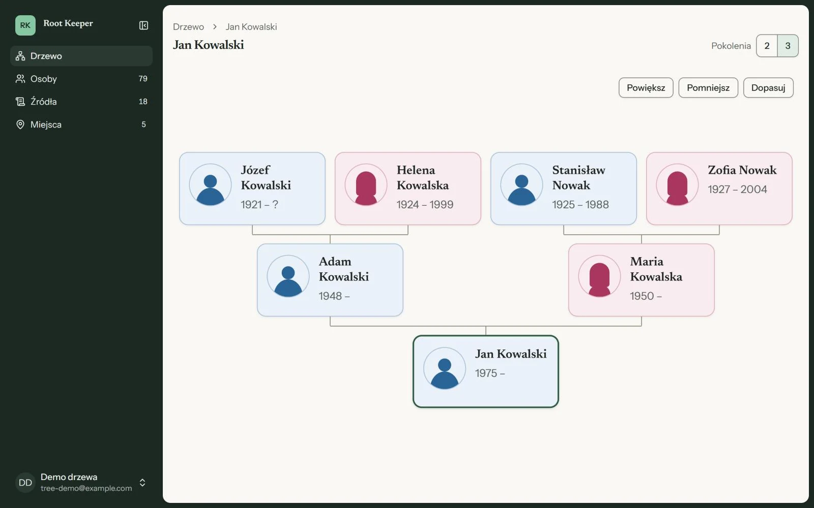
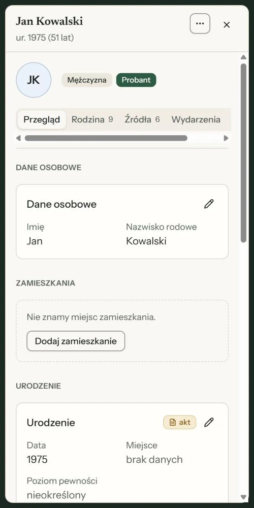

<div align="center">

# Root Keeper

**Drzewo genealogiczne, w którym każda data ma źródło: akt parafialny, akt stanu cywilnego albo nagrobek.**

[](https://genealogy.kostecki.dev)
[](../../releases/latest)
[](../../actions/workflows/tests.yml)
[](../../actions/workflows/e2e.yml)
[](CHANGELOG.md)

[](https://www.php.net/)
[](https://laravel.com/)
[](https://inertiajs.com/)
[](https://react.dev/)
[](https://www.typescriptlang.org/)
[](https://tailwindcss.com/)
[](https://www.postgresql.org/)

[Aplikacja](https://genealogy.kostecki.dev) · [Changelog](CHANGELOG.md) · [Roadmapa](context/foundation/roadmap.md) · [Zgłoś błąd](../../issues/new)

[English](README.md) · **Polski**

</div>

<p align="center">
  
</p>

## O projekcie

Root Keeper to prywatne, samodzielnie hostowane drzewo genealogiczne do badań prowadzonych po godzinach, w których „chyba” nie wystarcza. Każde urodzenie, małżeństwo i zgon może wskazywać akt, który je potwierdza, razem ze skanem, numerem wpisu i poziomem pewności. Każde konto ma dokładnie jedno drzewo i widzi tylko swoje dane. Interfejs jest po polsku.

## Funkcje

- **Arkusz rodziny** — drzewo startuje od razu po zalogowaniu i wypełnia okno: rodzice, dziadkowie, małżonkowie i dzieci wokół osoby w centrum, a relacje dodajesz prosto z pustych miejsc.
- **Widok przodków** — wywód z przełącznikiem liczby pokoleń (2–5), powiększaniem i przesuwaniem.
- **Źródła ze skanami** — akty parafialne i stanu cywilnego, księgi i nagrobki opisane rodzajem, parafią, rokiem, typem aktu, archiwum i sygnaturą, każde ze skanem, podpięte do faktów z numerem wpisu.
- **Daty nieostre i pewność** — data dokładna, „ok.”, zakres lat, „przed” albo „po”, plus poziom pewności A–D (akt pierwotny, indeks, wskazówka, hipoteza).
- **Osoby** — warianty zapisu nazwiska znajdowane przez wyszukiwarkę, nazwisko rodowe, forma ślubu, zamieszkania z latami i oś wydarzeń z wiekiem.
- **Spis miejsc** — miejscowości z wariantami nazw, parafie i urzędy oraz cmentarze na jednej stronie, ze scalaniem duplikatów.
- **Import z repo badawczego** — `import:research` czyta ustrukturyzowane bloki danych z notatek badawczych w Markdownie, pokazuje podsumowanie, dopasowuje osoby wpisane ręcznie, pozwala rozstrzygać konflikty pojedynczo i zapisuje tylko to, co zatwierdzisz. Kolejny import aktualizuje zamiast dublować.
- **Logowanie** — hasło albo klucz dostępu, weryfikacja e-maila i limit prób rejestracji.

<table>
  <tr>
    <td width="66%"></td>
    <td width="34%"></td>
  </tr>
  <tr>
    <td align="center"><sub>Widok przodków</sub></td>
    <td align="center"><sub>Panel osoby z urodzeniem potwierdzonym aktem</sub></td>
  </tr>
</table>

<sub>Zrzuty pokazują wymyśloną rodzinę z `TreeViewDemoSeeder`.</sub>

## Stos technologiczny

| Warstwa | Technologia |
| --- | --- |
| Backend | PHP 8.5, Laravel 13, Inertia 3, Fortify (hasła i klucze dostępu), Wayfinder |
| Frontend | React 19 z React Compilerem, TypeScript, Tailwind CSS 4, shadcn/ui, Vite+ (Oxlint, Oxfmt) |
| Baza danych | PostgreSQL 18 |
| Jakość | Pest 5 / PHPUnit 13, Larastan poziom 7, Laravel Pint, Vitest, Playwright |
| Infrastruktura | Laravel Sail lokalnie; Docker Compose za Traefikiem na VPS, szyfrowane kopie Spatie |

## Uruchomienie

### Wymagania

- Docker ([Laravel Sail](https://laravel.com/docs/sail)); każde polecenie `php`, `artisan`, `composer`, `npm` i `npx` idzie przez `vendor/bin/sail`

### Instalacja

```bash
git clone https://github.com/sebastian-kostecki/root-keeper.git
cd root-keeper

cp .env.example .env
./vendor/bin/sail up -d
./vendor/bin/sail artisan key:generate
./vendor/bin/sail artisan migrate --seed
./vendor/bin/sail npm install
./vendor/bin/sail npm run dev
```

Aplikacja działa pod <http://localhost:8000> (`APP_PORT`).

### Dane demo

```bash
./vendor/bin/sail artisan db:seed --class=TreeViewDemoSeeder   # tree-demo@example.com / password
./vendor/bin/sail artisan db:seed --class=AncestorsDemoSeeder  # ancestors-demo@example.com / password
```

`migrate --seed` tworzy `test@example.com` / `password` z pustym drzewem. Dwa seedery demo zakładają własne konta z wymyśloną rodziną (pierwszy także ze źródłami i skanami) i podmieniają je przy kolejnym uruchomieniu.

## Praca nad kodem

| Polecenie | Co robi |
| --- | --- |
| `sail composer test` | Lint, Larastan i testy Pest |
| `sail composer types:check` | Larastan (poziom 7) |
| `sail bin pint --dirty --format agent` | Styl kodu |
| `sail npm run check` | Oxfmt i Oxlint (ostrzeżenie przerywa build) |
| `sail npm run types:check` | TypeScript |
| `sail npm run test:js` | Vitest |
| `npx playwright test` | E2E Playwright na osobnym kontenerze Sail na porcie 8100 |

Cztery workflowy GitHub Actions uruchamiają się na każdym pushu i pull requeście:

| Workflow | Co sprawdza |
| --- | --- |
| [`lint`](.github/workflows/lint.yml) | Oxlint i Oxfmt, ostrzeżenia traktowane jak błędy |
| [`static-analysis`](.github/workflows/static-analysis.yml) | Larastan poziom 7 |
| [`tests`](.github/workflows/tests.yml) | Testy Pest (feature i unit) |
| [`e2e`](.github/workflows/e2e.yml) | Testy end-to-end Playwright |

Praca toczy się na `develop`, `main` to gałąź wydań.

## Jak powstaje

Produkt kształtuje się w [`context/foundation/`](context/foundation/): PRD, roadmapa, infrastruktura, plan testów i kontrole zdrowia. Każda zmiana dostaje własny folder w `context/changes/` z researchem, planem i przeglądem implementacji, a po wdrożeniu trafia do [`context/archive/`](context/archive/). Agenci (Claude Code) pracują według [`CLAUDE.md`](CLAUDE.md), a każda zmiana wchodzi przez pull request z zielonym CI.

## Wdrożenie

Produkcja działa na VPS z `docker-compose.prod.yml` za Traefikiem. `scripts/deploy.sh` robi kopię bazy (`backup:run --only-db`) przed każdym `migrate`; nocne kopie są szyfrowane. Szczegóły: [`context/foundation/infrastructure.md`](context/foundation/infrastructure.md).

## Status projektu

Wersja **0.3.1** działa na produkcji pod [genealogy.kostecki.dev](https://genealogy.kostecki.dev). Kamień milowy M-3 „Badania z repo widoczne w drzewie” jest zamknięty; zobacz [roadmapę](context/foundation/roadmap.md) i [changelog](CHANGELOG.md).

## Licencja

Projekt nie ma jeszcze licencji open source, więc wszelkie prawa są zastrzeżone © Sebastian Kostecki. Kod można czytać; przed ponownym użyciem zapytaj.
